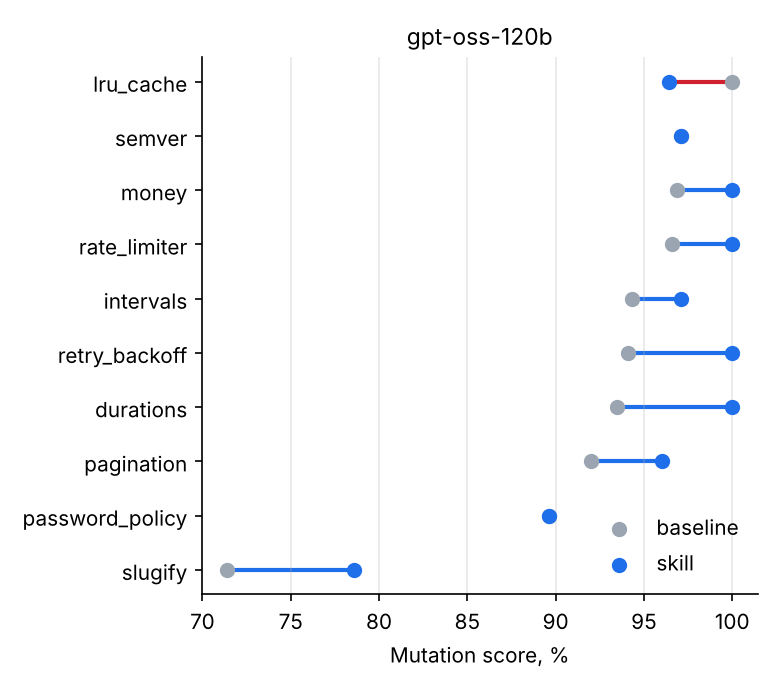

# test-writer — an agent skill for tests that actually catch bugs

[](https://github.com/sofetizm/test-writer/actions/workflows/ci.yml)
[](https://colab.research.google.com/github/sofetizm/test-writer/blob/main/notebooks/benchmark_colab.ipynb)


**[Русская версия](README.ru.md)**

AI assistants write tests that pass. That is not the same as tests that **fail when the
code is wrong**. `test-writer` is an [Agent Skill](https://agentskills.io) for Claude Code,
Codex CLI, GitHub Copilot, Cursor, Gemini CLI and other agents. It makes the agent check its
own tests with **mutation testing**: small bugs are injected into the code, and the agent
keeps improving the tests until they catch them.

The repository also contains a **benchmark** that measures whether the skill helps:
the same model writes tests for 10 modules with and without the skill, and the tests are
scored by how many injected bugs they catch.

## The problem in one example

A typical AI-written test for a pagination helper:

```python
def test_paginate():
    result = paginate(45, 2)
    assert result is not None
    assert result["page"] == 2
    assert result["has_next"]
```

It passes. Now the skill's script injects 25 bugs into `paginate` and runs the test:

```text
$ python mutation_score.py --module pagination.py --tests tests/test_pagination.py
Mutation score: 40.0%  (10/25 mutants killed, 15 survived, 0 timeouts) in 9.9s

Surviving mutants (behaviour that no test checks):
  line 12:8    `<` -> `<=`                        | if total < 0:
  line 19:22   `//` -> `/`                        | pages = max(1, -(-total // per_page))
  line 25:20   `-` -> `+`                         | "offset": (page - 1) * per_page,
  line 26:21   `>` -> `>=`                        | "has_prev": page > 1,
  ...
```

60% of these bugs would ship unnoticed. With the skill, the agent reads this list and
adds the missing boundary and field checks until the survivors are gone (or proven
equivalent).

## Install

With the `skills` CLI (installs into the folders of the agents you have):

```bash
npx skills add sofetizm/test-writer
```

Or copy `skills/test-writer/` into the skills folder of your agent:

| Agent | Project | User (all projects) |
|---|---|---|
| Claude Code | `.claude/skills/test-writer/` | `~/.claude/skills/test-writer/` |
| Codex CLI | `.agents/skills/test-writer/` | `~/.agents/skills/test-writer/` |
| GitHub Copilot | `.github/skills/test-writer/` | — |
| Cursor | `.cursor/skills/test-writer/` | — |
| Gemini CLI | `.gemini/skills/test-writer/` | — |

Then just ask: *"write tests for `src/billing/discounts.py`"*. The agent loads the skill
when the task is about tests.

Requirements in the project: Python 3.10+ and pytest. Hypothesis is used if installed.

## What the skill makes the agent do

1. **Plan before writing**: behaviours, branches, boundaries (`b-1`, `b`, `b+1` for every
   comparison), error paths, invariants, state changes.
2. **Write precise tests**: exact expected values, whole-structure comparisons,
   `pytest.raises(..., match=...)`, parametrized boundary tables, property-based tests
   for invariants, injected clocks instead of `sleep`.
3. **Run on the original code**. A failing test is either a wrong expectation (fix the
   test) or a real bug (keep it as `xfail(strict=True)` and report it). The code under
   test is never changed to make tests pass.
4. **Run mutation testing** and fix every surviving mutant, or explain why it is
   equivalent. Stop at ≥ 90% or after 4 iterations.
5. **Report**: what is covered, the final score, bugs found.

Files: [`SKILL.md`](skills/test-writer/SKILL.md),
[`references/checklist.md`](skills/test-writer/references/checklist.md),
[`references/patterns.md`](skills/test-writer/references/patterns.md),
[`references/anti-patterns.md`](skills/test-writer/references/anti-patterns.md),
[`scripts/mutation_score.py`](skills/test-writer/scripts/mutation_score.py).

## The mutation script on its own

`mutation_score.py` is a single file with no dependencies besides pytest. You can use it
without any AI, e.g. in CI or code review.

```bash
python skills/test-writer/scripts/mutation_score.py --module src/pkg/mod.py --tests tests/test_mod.py
python skills/test-writer/scripts/mutation_score.py ... --json          # machine-readable
python skills/test-writer/scripts/mutation_score.py ... --deselect-failing
```

- **Operators**: arithmetic (`+ - * / // % **`), comparisons, `and`/`or`, removing `not`
  and unary minus, negating `if` conditions, constants (`0↔1`, `n→n+1`, `True↔False`),
  `return x → return None`, deleting call statements (`items.append(x)`),
  `min↔max`, `any↔all`.
- **Safe**: the project is copied to a temporary directory; your files are never touched.
- **Fast**: mutants run in parallel; `pytest -x` stops at the first failure; infinite
  loops created by a mutant are cut by a timeout and count as caught.
- **Honest**: it refuses to score if the tests fail on the original code, and it detects
  when `import pkg` resolves to an installed copy instead of your source (in that case
  mutations would be invisible and every test would look useless).
- Docstrings, type annotations and `if __name__ == "__main__"` blocks are not mutated.

## Benchmark

**Question:** does the skill make an agent write tests that catch more bugs?

**Design**
- 10 small but tricky modules in [`bench/tasks/`](bench/tasks): durations, intervals,
  money rounding, slugs with Cyrillic transliteration, an LRU cache, a password policy,
  a token-bucket rate limiter, pagination, semantic versions, retry backoff.
- The same model, prompt protocol and tools in every condition:

  | Condition | What the agent has |
  |---|---|
  | `baseline` | write the test file, run pytest |
  | `skill` | + `SKILL.md` in context, references on demand, the mutation script as a tool |
  | `skill-text` | ablation: the skill text and references, but **no** mutation script |

- The agent works in up to 6 turns through a plain-text action protocol, so any chat
  model works: API models and small local models alike.
- **Metric:** mutation score of the final test file. Tests that fail on the correct code
  are excluded before scoring (otherwise a wrong test would "catch" every mutant).
- **Ceiling:** hand-written reference suites in [`bench/reference/`](bench/reference)
  reach 100% on 8 tasks; on 2 tasks the remaining survivors are *equivalent* mutants
  that no test can catch ([`bench/ceiling.json`](bench/ceiling.json)). Scores are also
  reported as % of this ceiling.
- **Statistics:** tasks differ a lot in difficulty, so the headline number is the
  **paired** difference skill − baseline on the same task, with a bootstrap 95% CI.

### Results

`gpt-oss-120b` via Groq (reasoning effort low, temperature 0, up to 6 turns), skill v0.1.

| | baseline | skill |
|---|---|---|
| Mutation score (mean of 10 tasks) | 92.5% | **95.5%** |
| Injected bugs **missed** by the tests (of 310) | 20 | **12 (−40%)** |
| Tests failing on correct code (excluded) | 0.9 / task | 1.4 / task |
| Turns / episode | 2.6 | 5.2 |
| Tokens / episode | 6.4k | 22.2k |
| Cost of 10 tasks at Groq paid prices | $0.019 | $0.058 |

**Paired difference skill − baseline: +2.9 p.p., 95% CI [+0.9; +4.8]**, better on 7 tasks,
equal on 2, worse on 1.



What this shows:
- **A strong model already writes good tests for small modules** (92.5%), so the absolute
  gain is small. The useful framing is the misses: the skill **cut the number of injected
  bugs that slipped through from 20 to 12**.
- The gain is exactly where the skill aims: surviving *constant* mutants (untested unit
  sizes, default values) fell from 14 to 7, *comparison* mutants (`<` vs `<=`) from 4 to 2.
- It costs **3.5× more tokens**: the agent iterates with mutation feedback. At API prices
  that is still well under a cent per module.
- The skill makes the agent write more ambitious tests, and more of them are wrong
  (1.4 vs 0.9 per task). The harness excludes them before scoring.
- In 5 of 10 skill episodes the agent did not finish within the 6-turn limit: it ran mutation testing
  before plain pytest, and it repeatedly guessed new expected values for failing tests.
  Both are addressed in skill v0.2 (*run pytest first; read the actual value; at most two
  attempts per failing case*). Re-running the benchmark with v0.2 is the next step.
- 10 tasks and one repeat: the confidence interval excludes zero, but treat the size of
  the effect as approximate.

Full tables: [`results/RESULTS.md`](results/RESULTS.md). Every episode's transcript and
final test file: [`results/gpt-oss-120b/`](results/gpt-oss-120b).

### Reproduce

```bash
pip install -r requirements.txt && pip install -e .
export OPENAI_API_KEY=...                                   # any OpenAI-compatible API
export OPENAI_BASE_URL=https://api.groq.com/openai/v1       # e.g. Groq free tier
python -m twbench.run --model openai/gpt-oss-120b --name gpt-oss-120b \
    --conditions baseline,skill,skill-text --reasoning-effort low --rpm 4
python -m twbench.report --results results
```

Runs are resumable: finished episodes are skipped, so a run stopped by rate limits
continues where it stopped. Every episode keeps the full transcript and the final test
file in `results/<model>/<task>/<condition>/r0/`.

Local model instead of an API: `--backend hf --model Qwen/Qwen2.5-Coder-7B-Instruct`
(needs a GPU; the notebook runs it on a free Colab T4).

## Repository layout

```
skills/test-writer/          the skill (this folder is what gets installed)
  SKILL.md                   workflow and rules
  references/                checklist, patterns, anti-patterns (loaded on demand)
  scripts/mutation_score.py  mutation testing, stdlib + pytest only
bench/tasks/                 10 modules under test
bench/reference/             strong reference suites (the ceiling)
bench/ceiling.json           ceiling scores and equivalent mutants
src/twbench/                 benchmark harness: agent loop, backends, scoring, report
notebooks/                   Colab notebook to run the benchmark for free
tests/                       tests of the mutation engine, the harness and the report
```

## Development

```bash
pip install -e ".[api,dev]"
pytest                 # ~1.5 min
pytest -m slow         # recomputes the ceiling, ~2 min
ruff check src tests skills bench/reference
```

## Limitations

- Python + pytest only.
- 10 tasks is a small benchmark: treat differences of a few points as noise and look at
  the confidence interval.
- Small, self-contained modules. Real projects have I/O, databases and large classes;
  the mutation script works there too, but the benchmark does not measure that.
- The benchmark agent is a simple loop, not the real Claude Code or Codex CLI. It tests
  the skill's content under identical conditions; behaviour inside each real agent can
  differ.

## License

MIT
