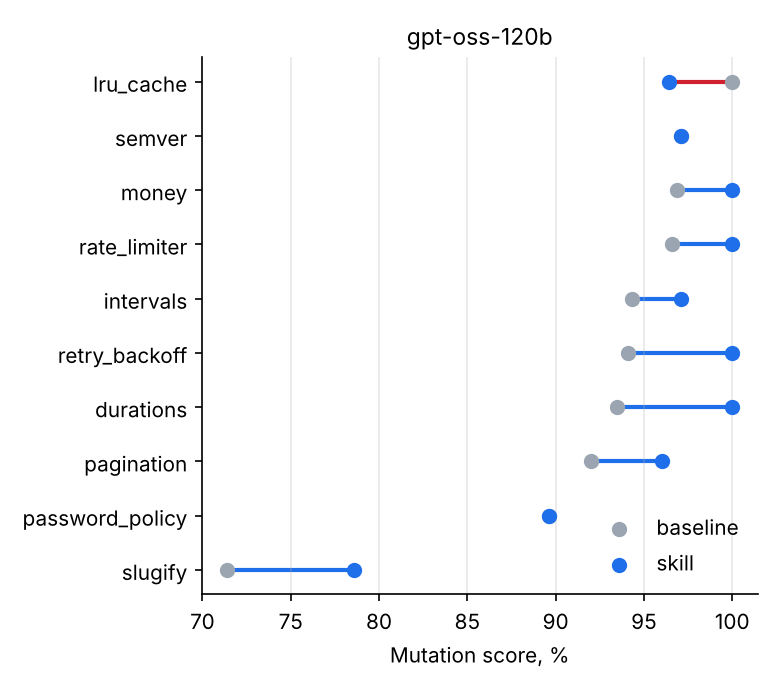

# Results

| Run | Condition | Episodes | Mutation score, % | % of ceiling | Valid suites, % | Passing tests | Tests failing on correct code | Turns | Tokens / episode | Cost, $ |
|---|---|---|---|---|---|---|---|---|---|---|
| gpt-oss-120b | baseline | 10 | **92.5** | 93.4 | 100 | 18.5 | 0.9 | 2.6 | 6433 | 0.019 |
| gpt-oss-120b | skill | 10 | **95.5** | 96.4 | 100 | 18.9 | 1.4 | 5.2 | 22239 | 0.058 |

## Paired difference: skill − baseline

| Run | Pairs | Mean Δ, p.p. | 95% CI (bootstrap) | Better / same / worse |
|---|---|---|---|---|
| gpt-oss-120b | 10 | **+2.9** | [+0.9; +4.8] | 7 / 2 / 1 |

## By task (mutation score, %)

| Task | gpt-oss-120b · baseline | gpt-oss-120b · skill |
|---|---|---|
| durations | 94 | 100 |
| intervals | 94 | 97 |
| lru_cache | 100 | 96 |
| money | 97 | 100 |
| pagination | 92 | 96 |
| password_policy | 90 | 90 |
| rate_limiter | 97 | 100 |
| retry_backoff | 94 | 100 |
| semver | 97 | 97 |
| slugify | 71 | 79 |

